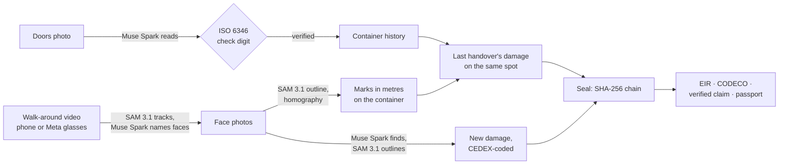

# Plomba

**A digital seal on a shipping container's condition at every handover.**


*Plomba* is Polish for the seal on a container's doors, the tag that proves the box wasn't opened. Plomba does the same for the container's condition.

On its way from a seaport to the customer, a container changes hands several times: ship, port terminal, train, inland terminal, truck, depot. Each handover moves liability for damage. Yet at most inland and rail terminals, the container's condition is still recorded on paper or in loose phone photos. When a dent turns up later, nobody can prove where it happened.

Plomba is an app for the checker doing the walk-around at a handover. It installs from the browser onto an iPhone or an Android phone. It uses Meta's models to see, read, listen and reason, and it keeps every mark on the container's own coordinates, so the next handover, in another city, sees the same damage on the same spot.

It's open source (Apache-2.0) and built to be self-hosted: a terminal, depot or rail operator runs one container on its own machine and keeps its data ([self-hosting](docs/self-hosting.md)).

**Try it:** a demo installation runs at https://app.plomba.lisovate.com (the access code is in the hackathon submission). It looks like an inland terminal three weeks in: a fleet of containers with sealed histories, walk-around videos and damage placed between two handovers, and a train due at Łódź. **No container nearby?** Its [Try page](https://app.plomba.lisovate.com/try) plays sample footage with the AR a checker sees: the tracked outline, the faces, the container's information and its recorded damage on the same spot. Sample door and face photos let you play a whole handover from a desk. The containers' movements, places and people are invented; the footage is openly licensed (see [Credits](#credits)).

The website, with the solutions for each kind of company and the hosted Plomba Cloud, is at https://plomba.lisovate.com.

## How a handover works

1. **Identify.** Point the phone at the doors. Muse Spark reads the container number, and the ISO 6346 check digit verifies it. Only a read that passes is accepted; anything else is a suggestion the checker taps. The container's history loads.
2. **Photograph, or record one walk-around.**
   - Each face photo is registered from SAM 3.1's outline of the container: four corners, a homography, and the photo is mapped onto the face in metres.
   - Or the checker records one walk around the container, on a phone or Meta AI glasses. SAM 3.1 tracks the container through every frame. Plomba picks the frames where a face is whole, and splits corner views into their two faces. Muse Spark names each face and flags frames that are blurred or blocked. The checker confirms, and the frames become the photos. The clip is kept with the handover as evidence, with people and number plates blurred, and its hash is sealed with the photos'.
3. **See the last handover.** Damage recorded at the previous handover is drawn on the same spot of the new photos, and over the live camera. The checker marks each item still there, changed or repaired.
4. **Record new damage.** Muse Spark finds and codes it (CEDEX damage and component codes), and SAM 3.1 outlines it. Or the checker just says it, hands-free: "wgniecenie, lewy bok, sekcja trzecia, na dole" becomes a coded proposal on that section (Muse Voice Transcribe, then Muse Spark). The checker confirms each proposal, and the location code comes from where the mark sits on the container. Faces and number plates are blurred before anything is stored.
5. **Seal.** The handover is hash-chained into the container's history. Out come:
   - an equipment interchange receipt (EIR) to print or save as PDF;
   - an EDIFACT CODECO gate message;
   - for new damage, a claim drafted by a Muse Spark agent, whose every cited item and hash is checked against the sealed records.
6. **Know where it happened.** The container's damage passport shows every damage coloured by the handover that first recorded it, between the last handover that photographed that spot clean and the first that didn't.



## Meta models

| Model | Job in Plomba |
|---|---|
| **SAM 3.1** | Outline the container to register each photo to its face; track it through walk-around videos (the AR anchor); find faces and number plates to blur; outline damage from Muse Spark's boxes |
| **Muse Spark** | Read the number, seals and placards; name the face in each walk-around frame; find and code damage, from a photo or from what the checker said; run the claim agent with tools, verified against the sealed records |
| **Muse Voice Transcribe** | Damage said aloud, coded by Muse Spark onto the sections named; spoken notes in Polish or English, biased to container vocabulary |
| **Muse Spark Open** (open weights) | The same vision jobs on open weights a company can host itself, through any OpenAI-compatible endpoint (measured, see below). Muse Glimmer can serve the same path |
| **Muse Image** | Synthetic damage for robustness tests, labelled as synthetic and never counted in reported accuracy |

## What we found about the models

Measured on openly licensed data, details in [docs/evaluation.md](docs/evaluation.md):

- **Muse Spark misreads worn numbers confidently.** The check digit catches it, but "repairing" a misread until the check digit passes was wrong 12 times out of 15. So only reads that pass as read are accepted. On 96 real crops: 61.5% verified with no input, and **0 wrong numbers accepted**.
- **Enlarging small photos doubled accuracy** (32% → 62% verified and right), at the same cost.
- **Open weights are as safe, just less convenient.** Muse Spark Open verified 54% of the same crops, again with 0 wrong numbers accepted. Every Muse Spark vision job (reading, naming faces, finding damage, coding spoken damage) also ran end to end on Muse Spark Open. One difference: it takes at most 8 images per request, so long walk-arounds go in runs.
- **Spoken damage codes reliably when the checker names the place:** 20 of 20 typed Polish and English notes coded exactly to CEDEX, on Muse Spark and on Muse Spark Open.
- **SAM 3.1 can't find damage by name** (`dent`, `damage` return nothing; `hole` finds bolt holes), **but it outlines damage precisely from a box.** So Muse Spark finds and codes, and SAM 3.1 outlines.
- **SAM 3.1 video tracking works as an AR anchor without AR hardware:** 450 frames in 26 s, with object IDs stable enough to keep the container's coordinates on it through a walk.
- **Muse Spark can tell left from right on a container** when it sees the walk-around frames in order, and it's helped by domain clues: containers ride doors to the rear. Geometry checks it: at a corner, the right-hand face always follows the left-hand one round the container.
- **One SAM 3.1 mask of a container seen corner-on gives two registered faces:** the near edge stands out of the outline's hexagon. On a 40 ft clip, 169 of 180 frames split.
- **For privacy, the prompt `face` beats `human face`** (6 of 7 faces, against 5), and every readable number plate was found.

## Status and limits

Everything above works end to end against the Meta Model API, with 200 unit and integration tests, and an end-to-end test of the whole handover on an Android phone (Chromium) and an iPhone (WebKit, Safari's engine), in CI. Progress is logged day by day in [docs/build-log.md](docs/build-log.md).

**Not yet:**
- **Live, world-tracked AR on iPhone:** Safari has no WebXR. Ghosts are drawn on photos, on recorded video and on the live camera, re-registered about every 1.5 s.
- **Faces that never fit in one frame** (close-range video) can't be registered yet. The app asks for a recording from further back.
- **Muse Glimmer** hasn't been run; Muse Spark Open has been, through the same path.
- **Dispute recordings labelled by speaker** are planned.
- **Real-container evaluation:** the reported accuracy is on public crops; the author's own photos are next.

Built for the **Meta Global AI Developer Hackathon 2026** (Startup Track, theme "Build for Your World"). Everything in this repository was created during the hackathon, starting 2026-10-26.

## Where to look in the code

| What | Where |
|---|---|
| Ports and adapters: every model behind an interface, wired in one place | [`apps/server/src/ports.ts`](apps/server/src/ports.ts), [`main.ts`](apps/server/src/main.ts) |
| Identification as a verifiable loop: model reads, check digit decides | [`services/identify.ts`](apps/server/src/services/identify.ts), [`core/iso6346.ts`](packages/core/src/iso6346.ts) |
| Marks in the container's own coordinates: homography, CEDEX codes and their inverse | [`core/geometry.ts`](packages/core/src/geometry.ts), [`core/cedex.ts`](packages/core/src/cedex.ts) |
| Walk-around: frame scoring, corner-view split, photo choice | [`core/walkaround.ts`](packages/core/src/walkaround.ts), [`routes/walkaround.tsx`](apps/web/src/routes/walkaround.tsx) |
| Damage passport: "it happened between these two handovers", only from sealed records | [`core/passport.ts`](packages/core/src/passport.ts) |
| Claim agent whose evidence is verified against the sealed records | [`services/claims.ts`](apps/server/src/services/claims.ts) |
| Hash chain over canonical JSON | [`core/hash-chain.ts`](packages/core/src/hash-chain.ts) |
| EDIFACT CODECO D.95B | [`core/codeco.ts`](packages/core/src/codeco.ts) |
| Every Meta model call, with prompts and JSON schemas | [`adapters/meta/`](apps/server/src/adapters/meta) |
| Evaluation scripts | [`apps/server/scripts/`](apps/server/scripts) |

## Quick start

```sh
npm ci
cp .env.example .env    # point META_API_KEY_FILE at a file holding your Meta Model API key
npm run dev:server      # API on http://localhost:8787
npm run dev:web         # app on http://localhost:5173
```

`npm run check` runs lint, type checks and tests. To run Plomba for real, with HTTPS and a phone, see [docs/self-hosting.md](docs/self-hosting.md): one Docker image, the key as a Docker secret, an optional access code.

## Documentation

- [docs/product.md](docs/product.md): users, the handover flow, scope for the hackathon, principles
- [docs/architecture.md](docs/architecture.md): components, how each model is used, walk-around videos, marks in container coordinates, the hash chain, the damage passport, data model, standards
- [docs/evaluation.md](docs/evaluation.md): measured accuracy on openly licensed data
- [docs/self-hosting.md](docs/self-hosting.md): running Plomba on your own machine
- [docs/integrations.md](docs/integrations.md): the API (OpenAPI), API tokens, signed webhooks, CODECO, and examples for shipping lines, rail operators, trucking companies and lessors
- [examples/README.md](examples/README.md): four runnable integrations (a claims desk, train arrivals, a driver's receipt, a lessor's fleet and off-hire reports), tested against a real Plomba server
- [docs/build-log.md](docs/build-log.md): dated log of what was built and when
- [apps/site/README.md](apps/site/README.md): the product website and its Plomba Cloud waitlist: building, running, exporting sign-ups
- [CONTRIBUTING.md](CONTRIBUTING.md): checks before committing, secrets, data and privacy rules

## Credits

The footage in the screenshots above and in the demo installation is openly licensed, CC BY 3.0:
- "How to buy a shipping container in 10 minutes" by Cowboy Steve Builds (YouTube);
- "40' reefer shipping container delivery and repositioning" by Life, Take 2 (YouTube).

The handovers and the damage passport in the screenshot show test data. People in the walk-around clip are blurred.

## Licence

[Apache-2.0](LICENSE). Third-party content keeps its own licence (see [NOTICE](NOTICE)).

## Author

Paweł Lisowski, [Lisovate](https://github.com/Lisovate), Gdynia, Poland
